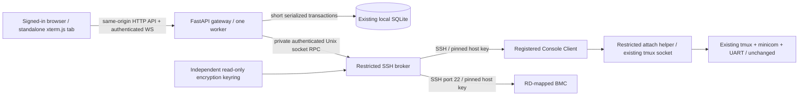

# Proposed system architecture

## Boundaries

The browser never connects directly to SSH. FastAPI owns identity, authorization, SQLite, tickets, quota and audit; broker owns outbound SSH, credential encryption/decryption and bounded transient byte queues. Proposed broker is a separate non-root sidecar using the same versioned image with a distinct entrypoint, no published port, no Docker socket, no database mount and no login-cookie signing key. Gateway has SQLite but not the root encryption keyring. Private Unix-socket volume and boot-scoped RPC capability authenticate peers. Broker validates signed/versioned capabilities and target restrictions independently. This reduces accidental exposure; a compromised authorized gateway can still request operations, so isolation is not a defense against all application compromise.

Both services retain UID10001, cap_drop ALL and no-new-privileges; no setuid/root bootstrap. Only gateway publishes existing 5088:80. This is a proposed future Compose amendment, not a change in this PR. One gateway worker is required; multi-host/process session ownership is unsupported and must fail deployment validation. Coordination scheduler remains independent and is not blocked by SSH work. Broker failure closes Console links while coordination continues; Console-enabled startup fails closed if keyring/broker configuration is invalid. Console disabled starts the original application without broker/key material.

## Access evaluation

Evaluate server-side on page entry, prepare, host-trust commit, ticket redemption, connect completion, every user-originated input/resize/control, and before broker enqueue. Output-only viewers undergo revocation/deadline checks too. All require active user, valid nonexpired login, completed password change, enabled Console, acceptable transport, nonarchived SUT and configured/eligible endpoint. A page may render Not Configured/permission guidance without opening SSH. Mapping/history edits require an active signed-in account independently of Claim; they do not confer terminal rights.

| Policy | RD with current Claim | Other RD | Lab Admin / Super Admin |
|---|---|---|---|
| `claim_only` (default) | read/write | deny, unless effective maintenance grant | read/write across both Labs |
| `shared_readonly` | read/write | read-only, grant can provide read/write | read/write across both Labs |
| `all_authenticated` | read/write | read/write | read/write across both Labs |

Admin access is still subject to account, transport, target, trust, quota and Client enablement checks; no override of same-Lab invariant. A reservation or queue offer is not Claim. Maintenance/OOS alone neither denies Console nor grants writes. A valid named-RD/named-SUT grant adds read/write only during Maintenance/OOS, never creates Claim or touches existing usage/queue/reservation. Durations 1/2/4/8/12/24h; expiry at the exact UTC instant, revocation, or return to Normal invalidates grant. Extension preserves created_at, caps at original +24h and causes no gap/disconnect when continuously authorized. Fresh grants after expiry use new IDs, no cooldown or automatic renewal. No grant notification is generated.

On loss of a write source: recompute all sources. If read access remains (e.g. shared_readonly), discard pending input and downgrade to read-only with explicit status; if none remains, close. Security/endpoint/trust invalidation always closes affected links even if admin/another grant still authorizes future access. No automatic reconnect after revocation. Grant extension does not revoke unrelated sessions. Own session inventory is read-only; no terminate-other-tab API, even for admins in this feature.

## Connection and resource lifecycle

1. Explicit Connect creates a short-lived flow after auth/policy/configuration checks. No background SSH/ICMP/session discovery and no SSH on mapping Save. Client onboarding/credential/IP/port verification is the explicit Q70–72 exception.
2. Reserve one of ten per-user slots transactionally, including Connecting and Reconnecting, across transports/tabs. Browser tab uses an opaque server-bound session ID; reconnect reuses that slot, with CAS connection generation so only one attachment survives. A new tab cannot steal a reconnect handle. Reject the 11th with a friendly quota error before SSH. Limit simultaneous auth attempts separately (proposed one per flow, two per user); no cross-flow password lockout.
3. Probe only SSH key exchange, without credentials. Unknown/changed key yields a challenge. Explicit out-of-band comparison and trust commit precede credentials; actual authentication must pin the same key on the same target/version, reconnecting safely if needed. Never trust merely because the network supplied a fingerprint.
4. UART decrypts the current Client secret only in broker memory. Direct BMC prompts fresh username/password, at most three explicitly submitted attempts in a flow; discard each attempt's credential and do not retry automatically. No persistent BMC secret. All SSH establishment (TCP, exchange, authentication, PTY/attach readiness) has a fixed ten-second budget per attempt, excluding human comparison/password-entry time.
5. UART attaches only the pre-existing mapped session through the restricted helper; BMC opens its authenticated interactive shell. TERM=xterm-256color. Disable agent/X11/TCP forwarding, SFTP/SCP, ProxyCommand and environment/command selection. Separate SSH connection per tab (no credential-sharing multiplex pool).
6. Establishment revalidates authorization and every version before exposing Connected. Focus first writable success only. Deduplicate participant count by RD per endpoint/transport; display names and read/write mode, plus Shared Console warning for 2+ UART RDs. Inventory covers gateway links only, not PuTTY.
7. Explicit Disconnect closes this SSH attachment, releases slot and keeps in-tab output; switch mode does likewise and requires a new Connect. Closing socket cancels outstanding authentication/probe work. Logout, login deletion/expiry, mandatory reset, deactivation, feature disable, endpoint revocation or archive close affected links. No keyboard-idle cutoff; auth lifetime remains fixed and is not extended by terminal traffic.
8. Transient network failure may use proposed backoff 1/2/4 seconds, maximum three retries within a 30-second reconnect grace, preserving one slot. Each retry revalidates versions/policy/trust. BMC pauses for fresh credentials if authentication is needed; no blind password replay. After grace/failure release slot, manual Connect obtains a fresh one. Never resend pending input or promise missed-output recovery.

Proposed heartbeat 15s / lost-link cleanup 45s uses network liveness, not keyboard inactivity; tolerate Chromium timer throttling using gateway WS ping/pong. Retained terminal buffer is browser memory only (10,000 lines); broker bounded queues are transient, never disk spooled. Broker and gateway register boot IDs; restart closes stale sessions, reconciles quota rows before accepting new ones and records metadata-only termination. No remote daemon/session creation or termination as recovery.

## UART attachment safety gate

Do not implement a generic shell string `tmux attach ...` exposed to browser input. Native tmux prefix/command mode could switch targets or kill/create windows, and attach can otherwise start a missing server. Proposed helper fixes an administrator-provisioned existing socket, validates an exact session name and pins its existing pane identity. It uses no-start-server behavior and restricted existing-session attachment; no new-session, kill-*, start-server, minicom launch or changes to remote tmux configuration/window-size policy.

Phase C must prove a helper/control-mode adapter can attach to existing tmux, emit ANSI pane output, pass literal terminal bytes including Ctrl+C/D/Z to the bound UART pane, and propagate native PTY sizing without exposing tmux command/prefix escape or changing server settings. It must not reinterpret terminal data as tmux commands. Read-only blocks all byte input at gateway and broker (including mouse reports, paste, automatic terminal replies); native read-only attachment is defense in depth. No writer lock: independent authorized writers' byte streams can interleave. Ordinary tmux attach alone is not accepted as the safety solution. See H1 in [compatibility](compatibility.md) for the unresolved prototype gate; no helper is installed by Phase A.

## Change confirmation, fencing and invalidation

All security-relevant changes use an optimistic version plus proposed-value digest, impact snapshot (SUT/RD/session counts and identities) and short-lived confirmation token. Preview is an explicit POST, not a GET side effect. Even a zero-session direct Save carries version information and rechecks impact under the transaction; a racing connection forces a new preview/confirmation instead of silent disconnect. Client credential and network changes additionally require successful pre-save authentication with a pinned trusted key, no command or shell. SSH I/O occurs outside the SQLite write transaction.

Commit sequence under per-endpoint admission fences (and Client fence for shared infrastructure), stable lock ordering Client ID then SUT/transport: validate actor, policy, versions, exact affected set and proof; fence new connects/input; broker pauses affected delivery and acknowledges; short BEGIN IMMEDIATE transaction applies change, immutable history/audit, increments epoch and durably marks sessions revoked; commit; broker closes only marked attachments; acknowledge result. Rollback resumes old versions/links. If broker cannot acknowledge a fence, fail the change before commit; fail closed on lost control channel. Crash after commit is recovered from durable revocation rows before input admission. In-flight network bytes already delivered before the fence cannot be undone; never claim physical rollback.

| Change | Scope |
|---|---|
| UART save/clear | This SUT's UART only |
| BMC save/clear or BMC host-key replacement | This SUT's BMC only |
| Client IP/port/username/credential/key trust/disable | All UART sessions using that Client |
| Client name/notes only | Audit, no disconnect |
| Grant/account/Claim change | Reevaluate impacted rights; revoke/downgrade only when rights lost |
| Client Lab move | Refuse incompatible bindings, never silently unbind |

Host-key replacement always requires counts, old/new fingerprints and confirmation. Failure of candidate credential/address verification retains old record, credential and links. A successful revocation never kills tmux, minicom or external SSH clients. All boundaries serialize with start/release, user/role changes, archive and operational-state services; do not use the 30-second UI poll as security enforcement. A broker auth lease proposed at most one second is refreshed by gateway; if refresh/database unavailable, pause input/output and close on lease expiry. Critical committed revocations use immediate fencing, not just this fallback lease.

Lease validity is also capped at the authenticated login's exact expiry and any sole effective grant's expiry, so queued bytes/output cannot continue past a known deadline while waiting for a sweep. Validate rights against server time before enqueue and again before delivery; expiration never refreshes itself through heartbeats. If another authorization source remains, gateway issues a newly evaluated mode/lease rather than extending the expired grant. Pending data from a revoked or replaced generation is discarded.
