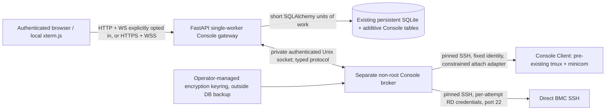

# Proposed architecture and state transitions

Normative owner input: [requirements](../CONSOLE_001_REQUIREMENTS.md).
All mechanisms in this document are engineering proposals pending Phase A review.
See [security](security.md), [schema](data-model.md), [contracts](contracts.md),
[review register](compatibility.md), and [acceptance](acceptance.md).

## Components and trust boundaries

Gateway owns HTTP/WS authentication, policy, SQLite transactions, tickets, epochs,
quota and sanitized audit. Broker owns SSH protocol parsing, PTYs, encryption and
transient secret handling. Browser supplies only resource IDs and typed controls,
never a raw SSH URL, Client credential, command, tmux socket path or forwarding
request. No Docker socket, host networking, privileged application or root SSH
requirement. Broker is a future private service/process, not a second Uvicorn
writer; no direct SQLite mount or browser-facing port. Data access remains through
the gateway. One backend instance owns all Console leases and revocation gates.
Horizontal scaling requires a separate reviewed distributed fencing design.

Future process boundary: web UID10001, broker proposed UID10002, shared private
socket group10001; broker-owned directory0750/socket0660, peer-UID checks plus
per-boot mutual capability handshake. Separate volumes expose keyring only to
broker; normal web credential-upload parsing nevertheless handles plaintext
briefly. This reduces exposure, **does not make a compromised authorizer safe**.
Future Compose changes retain web5088→80, private network, dropped capabilities,
no-new-privileges, UID10001 and persistent `/app/data/sut.db`. No deployment change
is made here. Broker egress has independent host firewall constraints.

## Integration with existing source

| Existing location | Planned integration / incompatibility |
| --- | --- |
| `backend/app/main.py` | Add Console router/lifespan supervision only when enabled; retain existing HTTP middleware and polling. Existing HTTP-only middleware does not protect WS frames. |
| `core/dependencies.py` | Current `Request`/HTTP-method transaction dependency cannot be reused as a long-lived WS DB session or around SSH validation. Extract shared auth resolver and use short units for WS/new pre-save flows. |
| `core/database.py` | Reuse `Base`, `UTCDateTime`, naming convention, WAL/FK and `BEGIN IMMEDIATE`; no SSH await while write reservation held. |
| `services/accounts.py` and auth logout routes | Deleted/expired LoginSession, reset/change password, disable and role changes must fence associated Console links/tickets; preserve account and coordination semantics. |
| `services/coordination.py` | Claim/Release changes re-evaluate Console rights, not the reverse. Reservation readiness alone is not a Claim. No Console-induced usage/history/queue/reservation mutation. |
| `services/inventory.py` | Archive/restore and operational-state changes update Console slot/grant eligibility and fence as needed, without changing existing archival blockers. Lab delete must also reject retained Console Clients. |
| `core/deadlines.py` | Separate local grant/lease expiry sweep may share lifespan supervision, not SSH monitoring. Existing reservation/offer sweep remains unchanged. |
| `models/domain.py`, Alembic `c2026101601` | Add separate Console entities; no conversion of existing inventory IP fields or reservation state. |

Console modules would be separate services/adapters and thin HTML/API/WS routers.
Pin maintained SSH, xterm.js and crypto dependencies in later implementation PRs;
serve terminal/search/fit assets locally under existing CSP, without SPA/CDN.

## Authorization predicate (at ticket, attach, every input and periodic output)

First require enabled feature, allowed browser transport, active account, current
unexpired server-side LoginSession, no mandatory password change, unarchived SUT,
configured endpoint, allowed destination, trusted current host key, enabled Client
for UART, current mapping/credential/trust generations, and quota reservation.
No role/grant overrides these prerequisites. Same-Lab UART is absolute.

`Admin` = current `lab_admin` or `super_admin` under existing BR-008 across both
Labs, with the same prerequisites; no invented Lab-admin assignment table.
`holder` = current usage owner of this SUT, not booking owner or queue member.
`grant` = own effective named grant while SUT is Maintenance/Out of Service,
`created_at <= now < expires_at`, not revoked, target account active.

| Actor/source | claim_only | shared_readonly | all_authenticated |
| --- | --- | --- | --- |
| Active Admin | read/write | read/write | read/write |
| Active current holder | read/write | read/write | read/write |
| Active other RD, no grant | deny | read-only | read/write |
| Active named RD with effective maintenance grant | read/write | read/write | read/write |
| Inactive / expired login / must-change-password | deny | deny | deny |

Maintenance/OOS does not deny Console by itself (Q76). Returning Normal revokes
those grants permanently; it never resurrects one on returning to Maintenance.
When Claim/grant/Admin rights disappear, recompute other sources: retain RW if
another applies; downgrade to RO if shared_readonly still permits reading; close
if no access remains. Block input before reporting downgrade. An already expired
and closed grant-dependent link never auto-reopens when a new grant is approved.
A grant-dependent attachment pins its grant ID: new grant creation first expires
and fences the old grant-dependent attachment, even if its socket has not yet
physically closed. A new grant cannot heal a gap or restart a previously expired
logical session. Only an independently continuous Claim/Admin/policy right can
keep that attachment authorized.

Mapping/host trust/credential invalidation closes that transport even if role or
Claim would otherwise permit it. No global grant notifications are generated.

RD mapping/history/trust authority is independent of Claim and access policy:
all active authenticated, password-changed users may edit/clear individual mappings
and inspect safe history, including retained archived history. Client host/port/
credentials/Lab/enabled/name/notes are Admin-only. Global flags/root keys are
operator-managed settings, not RD or Lab Admin system-configuration controls.

Read-only is enforced at gateway **and broker**, not xterm UI alone: reject data,
paste, Send Key, mouse-generated input and emulator automatic terminal replies.
Allow output/search/selection and bounded resize metadata. UART requests tmux's
read-only client attachment too. BMC RO blocks gateway input; remote login/profile
side effects cannot be promised absent. Shared input may interleave/corrupt commands; safe connection audit cannot attribute
individual keystrokes to a writer because Q10/Q15 prohibit that tracking.
No physical exclusive-access guarantee.

## Connect and lifecycle

1. Open standalone `/suts/{id}/console` from SUT Detail. Feature off hides/disables
   Console; unconfigured modes remain visible when enabled. Page opening and mode
   selection do not probe SSH. Display Not Connected, operational state/reason.
2. Connect POST validates principal/policy/endpoint and reserves one logical quota
   slot in a short transaction. Issue single-use, short-lived session-bound WS
   ticket. For unknown/changed trust, return a fingerprint challenge without sending
   any password/private key to the host. Credentials are requested only after trust.
3. Consume ticket and recheck everything. Broker makes exact pinned-IP SSH transport,
   host-key verification and authentication, then PTY with TERM=xterm-256color.
   Fixed10s establish timeout covers TCP/KEX/auth; human prompts run outside that
   deadline and a fresh handshake revalidates the approved key afterward.
4. UART uses the Client's fixed encrypted identity, constrained existing-session
   check/attach only, with no-start-server behavior. Never create/kill tmux/minicom or fall back to a Client shell.
   Read [tmux confinement gate C1](compatibility.md) before implementing this path.
   Direct BMC uses supplied per-attempt username/password and fixed22, independent
   PTY/shell; no gateway-supplied diagnostic/firmware/power command.
5. Connected streams bounded bytes and participant status; output is not recorded.
   Each UART browser has its own SSH attachment to the same existing tmux. Multiple
   authorized writers interleave naturally; no writer lock or latest-typist field.
   Show distinct Web RD names/count and RO/RW, warn prominently for2+ UART RD.
6. Disconnect closes only this tab's WS/channel/SSH and releases quota; retain
   in-tab scrollback. Mode switch disconnects then requires another explicit Connect.
   Never signal remote processes or external PuTTY sessions.

Public states: Not Connected → Connecting → Connected; transient loss →
Reconnecting → Connected or Failed; explicit Disconnect → Disconnected. Revocation
→ Disconnected with reason and manual Connect only. Disable input outside Connected.
No keyboard-idle timeout. Login's persisted expiry still applies even when output
is streaming; cookie renewal does not extend LoginSession.expires_at. Background
tabs receive output as browser/network allow, with no delivery guarantee in sleep.

Proposed retries: three transient retries at1/2/4s, then manual Retry. Manual
Reconnect always visible, disabled during Connecting/Reconnecting; Connected asks
confirmation, cancellation leaves link intact. Reconnect closes old attachment
first, keeps one logical slot, rechecks epochs/auth and never replays input. BMC
re-auth prompts again; at most3 user-submitted credential attempts per flow, clearing
password after every attempt. No cross-flow failed-auth lockout or automatic
password retry. Proposed maximum2 concurrent BMC auth attempts/user within10 slots,
with proposed process-wide cap16 concurrent SSH authentications (including explicit
Admin validations); this is a concurrency bound, not an auth lockout.

## Quota, liveness and expiry

Logical session owns `(user_id, slot_number)` with slot1–10 and a DB unique index.
Reserve counts Connecting/Connected/Reconnecting, including RO and both transports.
The11th concurrent reservation loses transactionally; do not count per SUT or user
identity merely once. Multi-tab reconnect tokens bind one logical ID and increment
attachment generation; an old WS cannot reacquire ownership or free a newer slot.
Idempotent disconnect compares current generation and terminal status.

Proposed heartbeat15s, dead-peer lease45s, Connecting lease30s; browser background
throttling uses server WS ping/liveness rather than keyboard events. Short grace
may consume a slot until cleanup, never an unbounded ghost allocation. Revocation
and login/grant expiry are checked on each input and at most2s during output-only
sessions (input never waits for sweep). Broker authorizations expire within2s if
control plane disappears; close attachments, do not keep privileged orphan SSH.
Every authorization lease is also capped at the real LoginSession expiry and,
when solely grant-dependent, that pinned grant expiry; a heartbeat cannot extend
either deadline. The broker enforces these NotAfter bounds locally.
Gateway/broker restart closes old sockets and finalizes prior instance's leases,
never reconstructs a terminal or automatically reconnects revoked sessions.
These numbers are engineering budgets, not additional owner-confirmed decisions.

## Mapping confirmation, pre-save SSH validation and revocation

Mapping Save does **no live probe**. Client create, credential replacement and IP/
port changes **must** perform pre-save trusted-key/auth-only validation without
shell, PTY, remote command or tmux. Candidate validation/draft stays in bounded RAM;
failed validation retains old record, credentials and links. No disabled/partial
Client row persists for failed onboarding. Avoid existing HTTP `database()` write
dependency around this network operation.

1. Read revisions and affected transport sessions; preview contains exact session
   IDs/attachment generations (private server digest), distinct SUT/RD/session
   counts, before/after nonsecrets and expiry. Confirmation required only when
   actual affected links exist, plus always deliberate changed-key acceptance.
2. For admin flows, validate candidate on SSH outside DB transaction. Successful
   evidence is bound to actor/login, operation, IP/port, observed key, current
   credential and Client revisions, candidate digest and short expiry. Never a
   reusable 'skip verification' Boolean. Recheck before commit; new IP trust must
   be accepted by that editing Admin. No auth with a mismatched/unapproved host key.
3. Acquire sorted per-user/Client/SUT/transport gates. Broker temporarily fences
   affected input/output and drains already-authorized sends **before** BEGIN
   IMMEDIATE. This barrier must not wait on SSH inside a DB write transaction.
4. Short write transaction rechecks actor, endpoints, name/IP/Lab/active-slot
   uniqueness, trust/credential versions, preview digest and exact affected live
   generations. A new/changed session or stale revision returns409 for a new preview,
   even if displayed counts match. Without affected links, direct Save is allowed,
   but a racing new link makes it require confirmation rather than silently saving.
5. Commit mapping/Client/trust revision, safe audit, affected lease revocation and
   durable revocation outbox together. Rollback restores old authorization/fences;
   failed credential testing never reaches this stage. Notes-only/name-only edits
   audit/update metadata version, not endpoint epoch or connection invalidation.
6. After commit broker closes affected attachments, discards stale queued frames,
   sends safe reason then closes WS. Outbox retries closure idempotently; mutation
   reply reports pending closure if broker cannot acknowledge. Frozen old links
   cannot send while pending; broker lease expiry is the fail-closed fallback.
   Do not claim a DB commit atomically closes a TCP socket. Bytes already delivered
   before the barrier cannot be recalled. Never retry revoked links automatically.

UART mapping edits affect only that SUT/UART; BMC edits affect only that SUT/BMC.
Client address/port/credential/key/disable changes affect every bound SUT/UART.
BMC trust replacement affects only that SUT/BMC. Identity-preserving encryption
rewrap is distinguished from an SSH credential replacement in the security design.

Existing Claim/Release, archive, Normal transition, role/account/password/logout
mutations need integration wrappers obtaining relevant gates **before** their
short database unit, plus transactional outbox hooks and post-commit invalidation.
Do not insert awaited broker calls inside today's already-open write dependency.
Gate acquisition order and barrier failure/rollback tests are Phase C blockers.
This authorization gate is not a UART writer lease: all valid writers remain
simultaneous. Every input batch is serialized only for authorization/fencing;
it does not select a privileged typist or provide remote-exclusive access.
